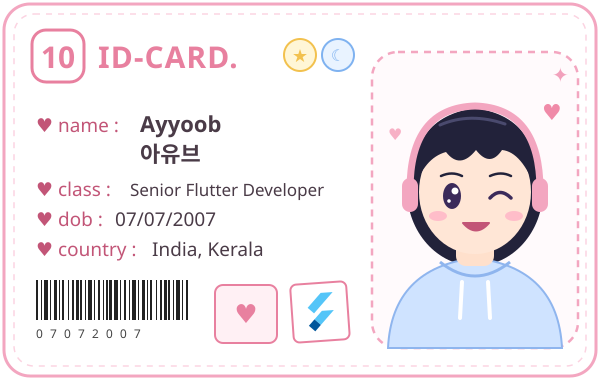

  

<h1 align="center">Hi, I'm Ayyoob 아유브 ♥</h1>

  <i>Developer · Learner · Anime fan ✦</i>

---

## ♥ About Me

- 👋 Name: **Ayyoob** (아유브)
- 💻 I love building things and learning something new every day
- 🌱 Currently learning: *(your topic here)*
- 🎌 Fun fact: big anime fan ✧

## ✦ Tech Stack

## ☾ GitHub Stats

  
  

## ♥ Contact

✧ Thanks for visiting! ✧

